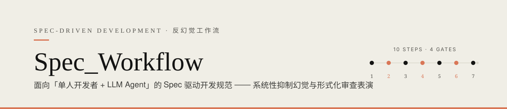
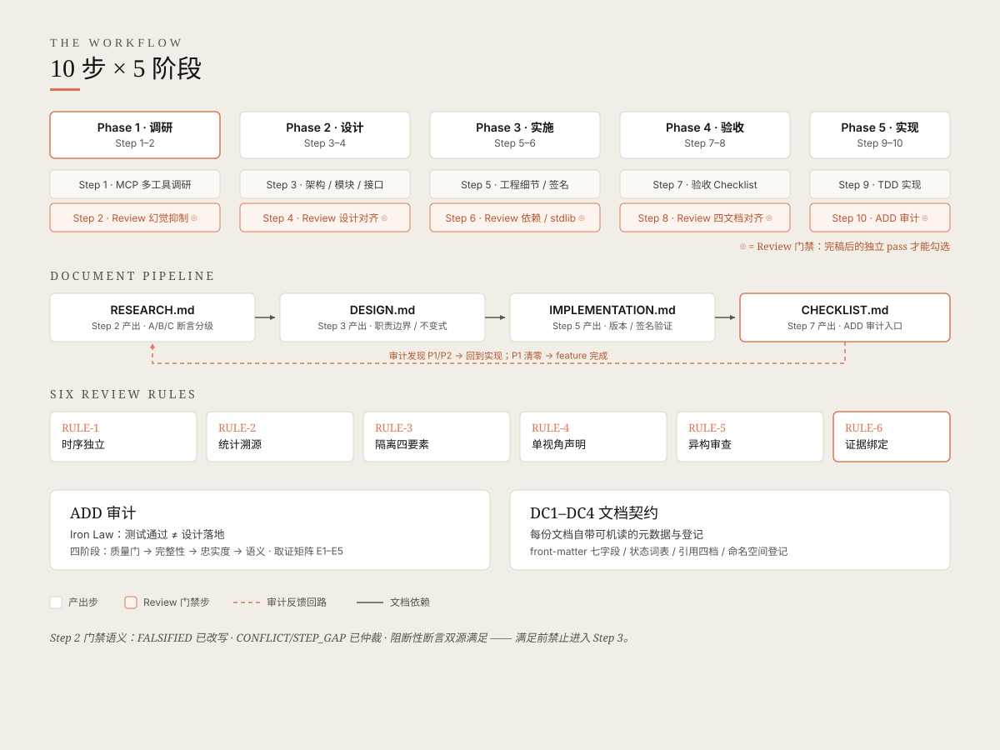
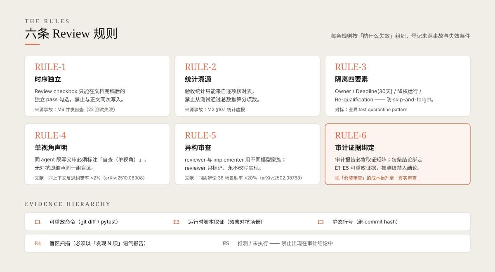
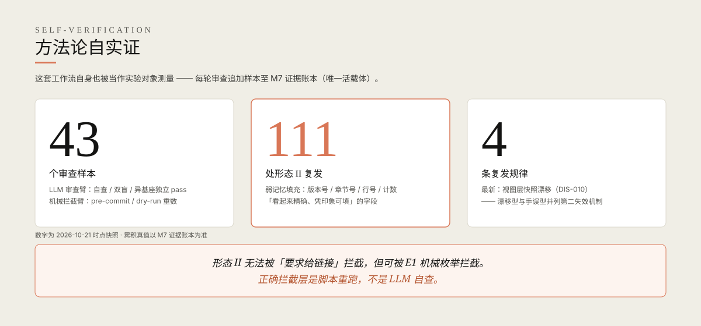

<p align="center">
  
</p>

**中文** · [English](README.en.md)

---

Spec_Workflow 是一套**纯文档型方法论（Layer-0）**：方法论本体无源代码、无构建系统、无运行时——纯文档消费者（阅读者 / 审计 / 外部 reviewer）零工具依赖即可完整使用；仓内另附一组**按需激活的 Layer-1 门禁工具**（校验器 / 派生视图生成器 / 门禁引擎），仅在提交时被动触发，未激活即「不存在」（见 [ADR-0010](adr/ADR-0010-lazy-loading-architecture-gate.md)）。它定义一个 10 步 Spec 流程及其配套审查机制，服务于「单人开发者 + LLM Agent」的工作流，核心目标是**最大限度抑制 LLM 生成内容中的幻觉与形式化审查表演**——任何 agent 框架都无法消除幻觉，只能某种程度地抑制；本框架通过证据分级、机械对账与流程门禁，把抑制落实为可检测、可拦截、可问责的机制——包括 LLM 自己做的审查。

> 这套体系不是理论设计。它从 math-finance-reasoning 项目的真实失效案例中长出来：M2 统计虚报、M6 并发自查、Phase 7C 幻觉清单自身含幻觉。每条规则都登记了来源事故与失效条件，且整套方法论自身也在被持续测量（见[方法论自测（无外部对照）](#方法论自测无外部对照)）。

## 设计哲学

一个不信任系统。五层不信任，各对应一个机制：

| 不信任什么 | 对应机制 |
|-----------|---------|
| LLM 断言 | 断言 A/B/C 分级 + 生成端强制证据 |
| LLM 自查 | Review 时序独立 + 异构基座复审 |
| 测试通过 | ADD Iron Law：测试通过 ≠ 设计落地 |
| 审查勾选 | 取证矩阵：每条结论绑定可重放证据 |
| 统计表 | 机械枚举：计数由脚本生成，禁止手填 |

## 工作流



**5 阶段 × 10 步**：调研（1–2）→ 设计（3–4）→ 实施（5–6）→ 验收（7–8）→ 实现（9–10）。每个偶数步是 Review 门禁，产出四文档管道 `RESEARCH → DESIGN → IMPLEMENTATION → CHECKLIST`。Step 10 的 ADD 审计发现 P1/P2 时回到实现，P1 清零才算 feature 完成。

## 六条规则与证据分级



**ADD 审计**（Audit-Driven Development）：Iron Law「测试通过 ≠ 设计落地」+ 四阶段审计（Spec 质量门 → 完整性 → 忠实度 → 语义）+ 取证矩阵。审计者永不自动修复——输出只标记问题，与 RULE-5 的单向权限同构。

**DC1–DC4 文档契约**（[ADR-0007](adr/ADR-0007-unified-document-contract.md)）：front-matter 七字段 / 状态词表 / 引用四档标注 / 命名空间登记。每份文档自带可机读的元数据，编号命名空间的权威登记在 ADR-0007 附录 A。

## 关键机制

除 10 步流程与六条 Review 规则外，本框架另有四组**可机械验证**的关键机制：

### 回写机制（Backflow）

上游输入在实施 / 验收阶段被推翻时，框架提供的是**机械回边通路**而非口头纪律。回写链共五段：① **产生**——`fork` 从既有事件流分叉出新流，原流保留；② **登记**——`fork` 可选三件（`--reason` / `--trigger-kind` / `--provenance`，all-or-none）成功后直写返工图；③ **检测·强制**——`finalize` 步强制 `metadata.upstream_impact ∈ {none, partial, overturned}`，非 `none` 即要求该 session 已登记返工图；④ **受理·对账**——`step-gate` 受理回退到上游步位的受控回边（同位重复仍判硬性），`backflow-audit` 报「待回写 / 待重入」、`rework_graph_check` 校验登记表自洽。真值源 = `docs/rework-graph.json`（触发枚举作唯一来源，守语义同源）。前四段已闭环；末段（视图侧「待重写 / 待重入」队列）维持 defer，触发 = 第一个真实回写事件。

### 控制台状态追踪（Console Status Tracking）

[docs/CONSOLE.md](docs/CONSOLE.md) 是 100% 由脚本生成的**纯派生视图**（唯一写路径），`scripts/console_gen.py` 在每次提交时刷新，`--check` 校验「与源一致」。状态真值源 = 「事件流 step 序表 ∪ feature 四文档 front-matter」（派生面）∪「人工裁决」（非派生面），并**按值域分流**：执行态（`done` / `in-progress`）由机器派生，决策态（`pending` / `blocked`）由人写——**同一位点单来源，禁双写**。视图侧以三档行动队列呈现，列头即状态行（状态词 + 机械计数 + DoR/DoD）。

### 懒加载架构门禁（Lazy-loading Gate）

[ADR-0010](adr/ADR-0010-lazy-loading-architecture-gate.md)：任何候选吸收（社区框架 / skill / MCP / 外部服务 / 本仓新增工具）前强制回答三问——① **放哪层**（Layer-0 纯文档 / Layer-1 工具）② **激活条件**（什么触发它从「登记」变「实现」，无触发即不实现）③ **未激活副作用 = 0**（不 import / 不启动 / 不扫描 / 文档层无感知）。它与「零依赖」互补：零依赖挡外部依赖引入，懒加载挡内部结构生长；**触发未满不动 = 不表演**。

### 吃狗粮开发（Dogfooding）

本仓用自己定义的流程开发自己。每个改动批次落一条 `specwf-p<NNN>-<date>` 决策流（`tools/spec_runner/sessions/*.jsonl`，五步 `research → design → implement → verify → finalize`），由 `step-gate` / `step-enforce` 门禁在提交瞬间强制校验——批次无决策流、或决策链不一致即阻断提交（`.pre-commit-config.yaml` 共 6 道 pre-commit 门禁）。首例 = P-020 step-gate（同时是 ADR-0010 三问的首个完整用例）。

## 方法论自测（无外部对照）



这套工作流自身也被当作实验对象测量——每轮审查/审计追加样本至 [M7_EVIDENCE_LOG.md](docs/M7_EVIDENCE_LOG.md)。截至 2026-10-24：样本 1-48，横跨 LLM 审查臂（同基座自查 / 异构双盲 / 真异基座独立 pass）与机械拦截臂（pre-commit 提交瞬间 / dry-run 重数），登记形态 II 复发 117 处、归纳 4 条复发规律——其中第 4 条「审计修正自身含计数错误」由异基座复验独立重跑发现，直接印证了 RULE-5 的实证基础。本段数字为时点快照，累积真值以 M7 账本为准。

## 仓库结构

```
Spec_Workflow/
├── SPEC_PROCESS.md            # 流程宪法：10 步 + 6 规则 + ADD + 取证矩阵
├── AGENTS.md                  # agent 工具进仓的行为对齐桥
├── CODE_WIKI.md               # 全仓详解 wiki
├── adr/                       # 架构决策记录 ×8（ADR-0004~0011，全 accepted）
├── docs/
│   ├── PROGRESS.md            # 待办登记（P 级任务真值源）
│   ├── CONSOLE.md             # 项目控制台（纯派生视图，提交即刷新）
│   ├── rework-graph.json      # 返工图真值源（回写链登记表）
│   ├── ASSERTION_EVIDENCE_FRAMEWORK.md  # 断言分级证据框架
│   ├── M7_EVIDENCE_LOG.md     # 审查对比臂数据账本（唯一活载体）
│   ├── discoveries/           # 发现三态索引（学习回路载体）
│   └── dev-log/               # 开发日志
├── scripts/                   # Layer-1：校验器 + 派生视图生成器
├── tools/spec_runner/         # Layer-1：门禁引擎（决策流 / step-gate / step-enforce）
└── spec/
    ├── templates/             # 6 个模板（四件套 + ADR + 决策矩阵）
    ├── doc-contract/          # 文档规范改造方案（verified）
    └── <feature>/             # 各 feature 四件套实例
```

## 快速开始

迁移到你的项目只需三步：

1. 复制 `SPEC_PROCESS.md`——v1.2.1 起自包含，正文中的 M6/M2 等历史案例可替换为你自己项目的教训，规则本身不变
2. 复制 `spec/templates/` 下 6 个模板到目标项目
3. 在 `spec/<feature>/` 下按 10 步流程开发，从 Step 1 调研开始

可选：`docs/ASSERTION_EVIDENCE_FRAMEWORK.md` 用于 Step 1–2 的调研断言分级；`CODE_WIKI.md` 是全仓详解，迁移前可通读。

## 文档索引

| 文档 | 定位 |
|------|------|
| [SPEC_PROCESS.md](SPEC_PROCESS.md) | 流程宪法：唯一权威入口 |
| [CODE_WIKI.md](CODE_WIKI.md) | 全仓 wiki：模块职责 + 依赖 + 历史教训案例库 |
| [adr/](adr/) | 八份 ADR：异质性 / 证据绑定 / 权威源 / 文档契约 / 门禁 / 发现日志 |
| [docs/ASSERTION_EVIDENCE_FRAMEWORK.md](docs/ASSERTION_EVIDENCE_FRAMEWORK.md) | 断言 A/B/C 分级 + 不对称配置 + 双盲重推导 |
| [docs/M7_EVIDENCE_LOG.md](docs/M7_EVIDENCE_LOG.md) | 方法论实证数据账本 |
| [docs/PROGRESS.md](docs/PROGRESS.md) | 待办登记：P 级任务真值源 |
| [docs/CONSOLE.md](docs/CONSOLE.md) | 项目控制台：纯派生状态视图 |
| [spec/templates/](spec/templates/) | 六份可直接复制的文档模板 |

## 许可

见 [LICENSE](LICENSE)。
